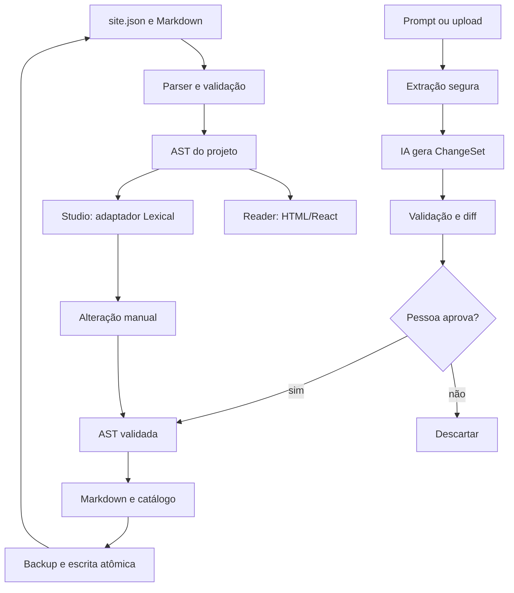

# Arquitetura da próxima versão

Status em 2026-10-20: **arquitetura proposta; implementação ainda não iniciada**.

O tema estático atual continua sendo a versão funcional e validada. A próxima versão migrará para
Next.js e TypeScript em etapas, sem misturar a migração com a criação do editor ou com a IA. O
[plano da próxima versão](PLANO-PROXIMA-VERSAO.md) define essa ordem. O
[plano do MVP atual](PLANO-MVP.md) continua como registro da versão `0.1.0`.

## O que existe e o que é proposta

| Área          | Implementado agora                                   | Proposta desta arquitetura                         |
| ------------- | ---------------------------------------------------- | -------------------------------------------------- |
| Base          | HTML, CSS, JavaScript, ES Modules e Web Components   | Next.js App Router, React e TypeScript             |
| Conteúdo      | `site/config.js` e fragmentos em `site/pages/*.html` | `site/site.json`, Markdown e AST validada          |
| URLs          | `#aba/pagina/titulo`                                 | `/aba/pagina#titulo`, com ponte para links antigos |
| Autoria       | Edição manual de arquivos                            | Estúdio visual e modo fonte                        |
| Configurações | Edição de `config.js`                                | Diálogo para site, abas e páginas                  |
| Tema          | Paleta atual fixa                                    | Botão claro/escuro com preferência persistida      |
| IA e upload   | Não existem                                          | Importação, `ChangeSet`, diff e confirmação humana |
| Contas        | Não existem                                          | Continuam fora desta versão                        |

Nada na coluna “Proposta” deve ser tratado como entregue antes de existir código e teste.

## 1. Resultado pretendido

O projeto continuará sendo uma base pública e genérica para documentação. Uma pessoa poderá:

- baixar o projeto e manter seus documentos em uma pasta local;
- ler a documentação com JavaScript mínimo e URLs estáveis;
- editar páginas visualmente, sem conhecer HTML;
- abrir o modo fonte e editar arquivos legíveis quando preferir;
- criar, renomear, ordenar e remover abas e páginas pela interface;
- importar documentos e revisar uma proposta gerada por IA;
- publicar somente o leitor, sem enviar editor, chaves ou ferramentas de importação ao visitante.

Contas, colaboração simultânea, permissões por usuário e integrações corporativas não fazem parte
desta atualização. São extensões futuras e não devem orientar o primeiro desenho de dados.

## 2. Princípios que não podem ser quebrados

1. **Conteúdo pertence ao autor.** Os arquivos ficam fora do código do tema e podem ser copiados,
   versionados e lidos sem um serviço proprietário.
2. **Leitor e editor têm pesos diferentes.** Quem apenas lê não baixa o editor, o chat, parsers de
   documentos nem bibliotecas de IA.
3. **IA propõe; código valida; pessoa aprova.** O modelo nunca escreve diretamente nos arquivos.
4. **Uma fonte de verdade por dado.** A ordem das abas e páginas fica no catálogo; o conteúdo fica
   no arquivo da página; segredos ficam fora de ambos.
5. **IDs e URLs são estáveis.** Renomear um rótulo não muda automaticamente um endereço já
   compartilhado.
6. **Recursos avançados são progressivos.** O texto básico funciona antes de colunas, embeds,
   importadores ou IA.
7. **Desempenho é um requisito medido.** Não basta dizer que o projeto é leve; cada etapa precisa
   respeitar orçamentos verificáveis.
8. **Acessibilidade é parte do componente.** Teclado, foco, leitores de tela, contraste e movimento
   reduzido entram no critério de aceite.

## 3. Decisões de tecnologia

| Área                  | Escolha inicial                                                                         | Motivo                                                                                                            |
| --------------------- | --------------------------------------------------------------------------------------- | ----------------------------------------------------------------------------------------------------------------- |
| Aplicação             | Next.js com App Router e TypeScript estrito                                             | Rotas por caminho, renderização no servidor, geração estática e separação entre componentes de servidor e cliente |
| Interface             | React, CSS global por tokens e CSS Modules                                              | Preserva o conhecimento atual de CSS e evita adotar um framework visual inteiro                                   |
| Componentes complexos | Radix Primitives, importado por componente                                              | Resolve foco e teclado em diálogo, menu, tooltip e popover sem impor aparência                                    |
| Editor                | Lexical com plugins escolhidos individualmente                                          | Núcleo pequeno, modelo próprio de documento, acessibilidade e foco explícito em desempenho                        |
| Animação              | CSS para estados simples; Motion com `LazyMotion` somente quando necessário             | Evita JavaScript em transições básicas e adia o custo das animações complexas                                     |
| Validação             | Zod nas fronteiras de arquivos, formulários e respostas da IA                           | O mesmo contrato valida entrada manual e saída de modelo                                                          |
| IA                    | AI SDK no servidor, por meio de uma interface de provedor                               | Evita acoplar o domínio a um único fornecedor e oferece saída estruturada                                         |
| Testes                | Testes unitários para domínio; Testing Library para componentes; Playwright para fluxos | Separa regras rápidas de testes reais de navegador                                                                |
| Monorepositório       | npm workspaces, sem orquestrador adicional no início                                    | Mantém comandos e dependências compreensíveis                                                                     |

Versões exatas só serão fixadas ao iniciar a migração. Bibliotecas de editor e IA mudam rápido;
copiar versões deste documento no futuro seria menos seguro que instalar a versão estável e validar
seus guias e changelogs naquele momento.

A comparação completa está em [Pesquisa de tecnologias](PESQUISA-TECNOLOGIAS.md). Lexical é a
decisão inicial, mas precisa passar pelo experimento da Etapa 2 antes de receber todos os plugins.

## 4. Separação entre leitor e estúdio

Uma única aplicação com editor e IA tornaria cada página pública mais pesada e impediria uma
exportação estática limpa. Por isso, a arquitetura-alvo possui duas aplicações que compartilham o
mesmo domínio:

```text
documentation-page/
├── apps/
│   ├── reader/                 # Next.js; site público e exportável
│   └── studio/                 # Next.js; autoria local e APIs de escrita
├── packages/
│   ├── content/                # esquemas, parser, migrações e repositório de conteúdo
│   ├── renderer/               # transforma o documento em React/HTML seguro
│   ├── editor/                 # Lexical e adaptadores; carregado somente no estúdio
│   ├── ai/                     # planos, prompts, provedores e validação de ChangeSet
│   ├── importers/              # Markdown, HTML, PDF e DOCX; somente no servidor
│   └── ui/                     # tokens e componentes compartilhados
├── site/                       # conteúdo de uma instalação; fora do tema publicado
├── examples/                   # instalação pública fictícia e versionada
├── docs/
├── package.json                # workspaces e comandos principais
└── README.md
```

Não será necessário criar todas essas pastas na primeira mudança. A migração começa com `reader`,
`content`, `renderer` e `ui`. `studio`, `editor`, `importers` e `ai` entram somente nas etapas em que
forem usados.

### Aplicação `reader`

- Usa Server Components por padrão.
- Gera HTML para cada página e envia apenas o JavaScript dos controles interativos.
- Pode produzir uma exportação estática para hospedagem simples.
- Não conhece chaves de IA, rotas de escrita nem o código do editor.
- Mantém tema claro/escuro com script pequeno e sem piscar o tema incorreto.

### Aplicação `studio`

- Executa localmente em Node.js no primeiro lançamento.
- Reutiliza o mesmo shell e o mesmo renderizador do leitor.
- Mostra os botões **Configurações**, **IA** e **Tema** no cabeçalho.
- Oferece APIs locais para salvar arquivos, importar documentos e chamar provedores de IA.
- Recusa escrita fora da pasta `site/` resolvida e validada.

No site publicado, o botão de tema continua disponível. Configurações e IA só aparecem quando o
estúdio está ativo. Esconder os botões no leitor não é um controle de acesso; as rotas de escrita
simplesmente não existem naquela aplicação.

## 5. Conteúdo portátil e editável à mão

### Estrutura de uma instalação

```text
site/
├── site.json                   # identidade, abas, páginas e ordem
├── pages/
│   ├── inicio.md
│   └── primeiros-passos.md
├── assets/
│   ├── imagens/
│   ├── audio/
│   └── video/
├── custom.css
└── .revisions/                 # histórico local, ignorado na publicação
```

`site.json` substitui o `config.js` como catálogo. JSON é escolhido porque a interface pode validar
e salvar o arquivo sem executar código. Um exemplo simplificado:

```json
{
  "schemaVersion": 1,
  "site": {
    "title": "Documentação de exemplo",
    "brand": "DOCS"
  },
  "tabs": [
    {
      "id": "guias",
      "title": "Guias",
      "pages": ["inicio"]
    }
  ],
  "pages": {
    "inicio": {
      "title": "Início",
      "source": "pages/inicio.md"
    }
  }
}
```

O catálogo define navegação e ordem. O arquivo Markdown define o conteúdo. O nome exibido da página
fica no catálogo durante a migração para evitar duas fontes de verdade. Metadados editoriais futuros
podem ser adicionados com um contrato versionado.

### Por que Markdown, e não HTML ou JSON do editor

Markdown é legível em qualquer editor, produz diferenças úteis no Git e preserva a autoria manual.
Recursos comuns usam CommonMark e GFM. Blocos que Markdown não representa, como colunas, callouts,
data, áudio e embeds, usam diretivas documentadas e não JavaScript arbitrário.

Exemplo conceitual:

```md
# Como reservar

:::columns
:::column

## Pelo site

Escolha uma data e confirme.
:::
:::column

## Pelo telefone

Tenha o código do hotel em mãos.
:::
:::
```

O formato interno pertence ao projeto. O estado JSON do Lexical existe somente enquanto a página é
editada. Ao abrir e salvar, adaptadores fazem `Markdown → AST do projeto → Lexical` e o caminho
inverso. Testes de ida e volta impedem que salvar sem alterações perca conteúdo.

HTML existente continua legível durante a migração. Uma página `.html` é marcada como legado e pode
ser convertida explicitamente para Markdown, sempre com cópia de segurança e prévia. Não haverá dois
arquivos editáveis concorrentes para a mesma página.

### AST do projeto

O parser transforma Markdown em uma árvore validada, independente do editor. O leitor renderiza essa
árvore sem importar Lexical. A IA também precisa devolver operações sobre essa árvore, não HTML.

Os primeiros tipos são: parágrafo, títulos, listas, tarefas, citação, código, tabela, divisor,
imagem, link, callout e toggle. Colunas, áudio, vídeo, data, arquivo e embed entram depois que os
tipos básicos estiverem estáveis.

## 6. URLs e compatibilidade

As novas URLs usam caminhos reais:

| Destino | URL                                |
| ------- | ---------------------------------- |
| Aba     | `/guias`                           |
| Página  | `/guias/primeiros-passos`          |
| Título  | `/guias/primeiros-passos#preparar` |

O `id` de aba e página é estável, minúsculo e com hífen. O texto visível pode mudar sem quebrar o
link. IDs de título explícitos são preservados; IDs automáticos seguem as regras já validadas no
tema atual.

Durante a migração, a raiz reconhece o endereço antigo
`/#guias/primeiros-passos/preparar` e redireciona no cliente para o novo caminho. Uma tabela de
aliases cobre IDs alterados conscientemente. Antes de remover a ponte, testes devem provar que os
links antigos publicados não são mais necessários.

## 7. Edição manual

O editor é um Client Component carregado apenas quando a pessoa seleciona **Editar**. A leitura e a
prévia continuam usando o renderizador comum.

### Primeira entrega do editor

- parágrafos e títulos `h1` a `h3`;
- negrito, itálico, sublinhado, tachado e links;
- listas ordenadas, não ordenadas e de tarefas;
- citação, divisor e bloco de código;
- desfazer/refazer e atalhos de teclado;
- menu de comandos com `/`;
- salvar manual, aviso de alterações pendentes e recuperação de rascunho;
- alternância entre visual, fonte Markdown e prévia.

Tabelas, colunas, toggles, mídias, datas e embeds não entram antes que salvar, recarregar e desfazer
este conjunto básico sejam confiáveis.

### Salvamento seguro

1. O cliente envia conteúdo, `pageId` e a revisão que abriu.
2. O servidor resolve o caminho a partir do catálogo; nunca aceita um caminho livre do cliente.
3. Zod valida o documento e o tamanho.
4. Se a revisão mudou, retorna conflito em vez de sobrescrever.
5. O servidor escreve um arquivo temporário dentro de `site/` e troca pelo destino.
6. Uma cópia anterior é registrada em `.revisions/`.
7. O cliente recebe a nova revisão e atualiza o estado de salvo.

O hash do conteúdo pode ser a revisão inicial. Histórico no Git é opcional; a aplicação não deve
executar `commit` ou `push` automaticamente.

## 8. Configurações de abas e páginas

O botão **Configurações** abre um diálogo com três áreas iniciais:

- **Site:** título, marca, idioma e tema padrão;
- **Abas:** criar, renomear, ordenar e remover;
- **Páginas:** criar, renomear, mover, ordenar, duplicar e remover.

Remover não apaga imediatamente. A interface mostra o impacto, exige confirmação e move o arquivo
para uma lixeira local recuperável. Renomear o título não altera o ID. Alterar um ID é uma ação
avançada que cria um alias de URL.

As operações usam o mesmo serviço de domínio usado pela IA. Assim, as regras de unicidade, caminho,
ordem e revisão não são duplicadas em componentes React.

## 9. IA com aprovação obrigatória

### Regra principal

A IA não recebe uma ferramenta `writeFile`. Ela recebe contexto e devolve um `ChangeSet` estruturado.
O servidor valida esse plano, a interface mostra uma prévia e somente uma confirmação explícita
aplica a transação.

```text
Prompt/arquivos
      ↓
Extração e normalização segura
      ↓
Formulário de intenção obrigatório
      ↓
IA gera ChangeSet com schema
      ↓
Validação determinística e cálculo do diff
      ↓
Prévia: aceitar, editar ou descartar
      ↓
Confirmação humana
      ↓
Backup + aplicação atômica + relatório
```

### Formulário obrigatório antes de enviar

O texto “O que vamos fazer hoje?” é seguido por campos que impedem um pedido ambíguo:

| Campo             | Opções iniciais                                                  |
| ----------------- | ---------------------------------------------------------------- |
| Abas              | Criar, editar, não alterar ou **IA decide**                      |
| Destino da aba    | Escolha existente ou nome da nova aba                            |
| Páginas           | Criar, editar, não alterar ou **IA decide**                      |
| Destino da página | Uma ou mais páginas existentes, ou nomes das novas páginas       |
| Conteúdo          | Anexar, inserir em uma seção, substituir seção ou criar rascunho |
| Preservação       | Trechos e títulos que não podem ser alterados                    |
| Objetivo          | Tutorial, referência, FAQ, resumo ou outro texto curto           |
| Público e nível   | Para quem é o documento e quanto conhecimento se espera          |
| Tom e idioma      | Exemplo: direto, português do Brasil                             |
| Fontes            | Arquivos anexos e instrução sobre qual fonte prevalece           |

“IA decide” é uma escolha manual e consciente, não ausência de escolha. Mesmo nesse modo, a IA só
propõe o destino. Criar uma nova aba ou página continua destacado na prévia.

### Contrato do `ChangeSet`

As operações permitidas são pequenas e auditáveis, por exemplo:

```ts
type ChangeOperation =
  | { type: "createTab"; tabId: string; title: string; position: number }
  | { type: "updateTab"; tabId: string; title?: string; position?: number }
  | { type: "createPage"; tabId: string; pageId: string; title: string; content: DocAst }
  | { type: "replaceSection"; pageId: string; headingId: string; content: DocAst }
  | { type: "appendContent"; pageId: string; content: DocAst };
```

Excluir fica fora da primeira versão da IA. A interface manual pode remover com confirmação e
lixeira; uma geração probabilística não precisa desse poder.

### Chaves de IA

- Chaves nunca entram em `site.json`, Markdown, Git, logs ou bundle do navegador.
- Em instalação local, o usuário pode informar uma chave temporária no diálogo. O servidor a mantém
  somente em memória durante a sessão e nunca a devolve à interface.
- Para uso recorrente, o caminho recomendado é variável de ambiente ou gerenciador de segredos.
- Uma instalação remota exige HTTPS, autenticação e autorização antes de habilitar o estúdio.
- A tela mostra apenas provedor, origem da configuração e os últimos quatro caracteres quando
  necessário; nunca mostra o valor completo salvo.

O primeiro adaptador usa AI SDK, saída estruturada e schema Zod. Provedores específicos ficam atrás
de uma interface. Modelo e limites são configuração de implantação, não dados fixos no tema.

## 10. Upload e importação

### Formatos iniciais

| Formato        | Tratamento                                                                          |
| -------------- | ----------------------------------------------------------------------------------- |
| `.md` e `.txt` | Parser direto, com detecção de codificação e limite de tamanho                      |
| `.html`        | Parser para AST permitido; scripts, eventos e URLs perigosas são descartados        |
| `.docx`        | Conversão no servidor, seguida de sanitização e mapeamento para AST                 |
| `.pdf`         | Extração de texto; a prévia avisa quando a ordem ou tabelas podem ter sido perdidas |

Planilhas, apresentações, áudio com transcrição e OCR ficam para etapas próprias. Aceitar um arquivo
não significa prometer fidelidade visual total.

Todo upload tem limite de tamanho, tempo e quantidade; nome de arquivo não define o destino; tipo
declarado e assinatura são conferidos; conteúdo extraído é tratado como não confiável. Parsers de
Office/PDF executam somente no servidor e, quando possível, em worker com timeout e limite de
memória. HTML convertido nunca é inserido diretamente com `dangerouslySetInnerHTML`.

### Figma, Miro e Notion

- **Figma:** primeiro como bloco de embed com URL permitida. Importar nós do arquivo é outro produto
  e exige API e autorização.
- **Miro:** primeiro como Live Embed permitido. Editar ou importar quadros exige fluxo próprio.
- **Notion:** primeiro por arquivo exportado em Markdown/CSV/HTML. Uma conexão ao vivo exige OAuth,
  seleção de páginas, sincronização e política de conflitos.

Embeds usam uma lista explícita de provedores, `sandbox`, `allow` mínimo e política de conteúdo. Uma
URL arbitrária não vira iframe automaticamente.

## 11. Desempenho e memória

O leitor é o produto mais acessado e recebe o orçamento mais rígido:

- nenhuma dependência de editor, IA ou importação no grafo inicial do leitor;
- HTML completo gerado no servidor ou no build;
- componentes de cliente apenas para navegação móvel, índice e tema;
- fontes do sistema por padrão; imagens com dimensões e carregamento tardio;
- destaque de código no build/servidor, sem runtime no navegador;
- prefetch limitado para não baixar páginas que a pessoa talvez não abra;
- animações por CSS e respeito a `prefers-reduced-motion`.

Metas iniciais, medidas em CI com uma instalação de referência:

| Cenário                             | Meta                                                        |
| ----------------------------------- | ----------------------------------------------------------- |
| Lighthouse mobile do leitor         | desempenho ≥ 95, acessibilidade ≥ 95                        |
| Core Web Vitals em teste controlado | LCP < 2,0 s, CLS < 0,1 e INP < 200 ms                       |
| JavaScript inicial de uma página    | até 180 KiB comprimidos, incluindo runtime                  |
| Troca entre páginas já geradas      | sem tarefa longa acima de 50 ms                             |
| Editor com 5.000 blocos             | digitação p95 abaixo de 50 ms no computador de referência   |
| Abrir editor                        | pacote do editor carregado somente após a ação de editar    |
| Abrir IA/importador                 | dependências carregadas somente ao abrir o respectivo fluxo |

Esses números são orçamentos, não resultados já alcançados. A Etapa 1 mede a base do Next.js; se o
runtime sozinho inviabilizar o orçamento, devemos ajustar a arquitetura antes de continuar, inclusive
reavaliando a escolha do framework para o leitor.

## 12. Segurança e privacidade

- Conteúdo público e conteúdo confidencial continuam sendo cenários diferentes.
- O leitor estático não protege documentos privados.
- O estúdio local escuta `127.0.0.1` por padrão e não deve ser exposto à rede sem autenticação.
- Toda operação de arquivo usa IDs validados e caminhos resolvidos dentro de `site/`.
- Markdown permite somente o conjunto documentado; HTML cru fica desabilitado por padrão.
- Uploads e respostas da IA são entrada não confiável.
- Prompts não recebem chaves, arquivos fora do escopo nem conteúdo de outras instalações.
- Logs registram operação, duração e quantidade, mas removem prompt, documento e segredo por padrão.
- Dependências de parser exigem auditoria de segurança e versão fixada.

Autenticação futura deve proteger APIs, páginas e anexos no servidor. Adicionar uma tela de login no
React não é proteção suficiente.

## 13. Erros, concorrência e recuperação

Estados diferentes recebem mensagens diferentes: arquivo inexistente, formato não suportado,
conteúdo inválido, conflito de revisão, acesso negado, limite excedido, falha de rede, falha do
provedor e resposta inválida da IA.

Requisições de navegação, importação e IA são canceláveis. Uma resposta antiga não substitui a
seleção atual. Alterações em vários arquivos usam uma transação lógica: criar backup, validar todos
os novos arquivos, aplicar e registrar o resultado. Se uma etapa falhar, restaurar o conjunto
anterior.

A recuperação mínima inclui:

- rascunho local para queda do navegador;
- revisões no servidor para salvar e operações da IA;
- lixeira recuperável para páginas removidas;
- exportação/backup manual da pasta `site/`;
- relatório claro dos arquivos alterados.

## 14. Testes e observabilidade

### Pirâmide de testes

- **Domínio:** schemas, IDs, rotas, AST, aliases, ChangeSet e conflitos.
- **Round-trip:** Markdown → AST → editor → AST → Markdown sem perda semântica.
- **Componentes:** teclado, foco e estados de diálogo, menu e editor.
- **Integração:** repositório de arquivos em pasta temporária, escrita atômica e recuperação.
- **Navegador:** leitura, edição, fonte, configurações, importação, prévia da IA e confirmação.
- **Compatibilidade:** cada página HTML atual abre no leitor novo e mantém sua URL por alias.
- **Desempenho:** bundle, Lighthouse e documentos grandes com limite de regressão.

Operações de IA registram localmente provedor, modelo configurado, duração, tokens quando
disponíveis, resultado da validação e aceite/recusa. Não registrar o conteúdo por padrão. O usuário
deve conseguir inspecionar o `ChangeSet` e o diff sem conhecer a API do provedor.

## 15. Fluxo completo



## 16. Decisões adiadas conscientemente

- contas e perfil do usuário;
- colaboração em tempo real e comentários multiusuário;
- banco de dados remoto;
- sincronização bidirecional com Notion, Figma ou Miro;
- marketplace de plugins;
- busca semântica e RAG sobre toda a documentação;
- publicação automática, domínio e analytics;
- permissões corporativas.

Adiar não significa esquecer. Significa impedir que problemas futuros obriguem o projeto atual a
carregar infraestrutura, memória e complexidade que ainda não produzem valor.
